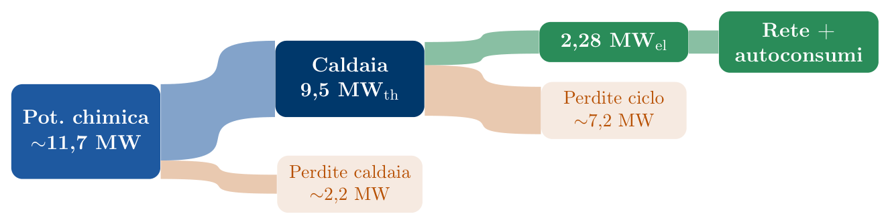
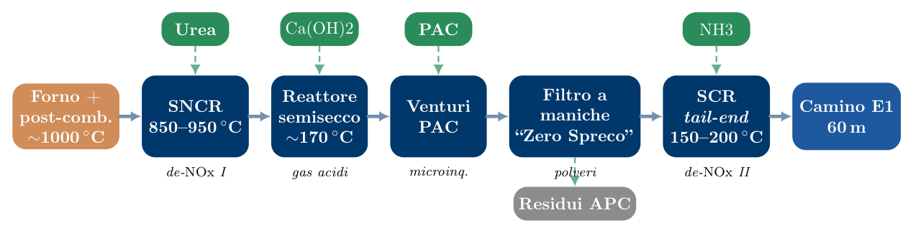

# San Zeno waste-to-energy plant: flue-gas cleaning against the EU Best Available Techniques

Analysis of the waste-to-energy line of the San Zeno plant (Arezzo, Italy), about 50 kt of waste per year, built on the operator's 2025 environmental data.

## Question

Does the plant's five-stage flue-gas cleaning meet the EU Best Available Techniques, and how much energy does the plant recover from the waste it burns?

## Answer

**Emissions: compliant, with margin.** All 11 stack parameters fall within the EU BAT emission levels (Decision 2019/2010). Seven of them (dust, CO, HCl, HF, SO2, Hg, dioxins) are below the lower end of the range.
<!-- src: report/report.pdf p.35 -->
The SCR unit added in 2023 moved NOx from 154.4 to 119.5 mg/Nm3, from the upper to the lower half of the range.
<!-- src: report/report.pdf p.35 -->

**Energy: just enough.** Of about 11.7 MW of chemical power in the waste, 2.28 MW leaves as electricity.
<!-- src: report/report.pdf p.11 (eq. 1-2, Figure 8) -->
The plant's R1 efficiency index reaches the 0.60 threshold for "recovery" status only thanks to the climate correction factor: without it, it would be 0.54.
<!-- src: report/report.pdf p.12 (eq. 9 and the sentence after it) -->

## Method

- **Waste and combustion:** elemental analysis of the fuel, calibrated on the EU Waste Incineration BREF; lower heating value (Dulong) checked against five years of operator data; combustion air and flue-gas composition and flow.
- **Mass and energy balance** of furnace, boiler and steam cycle, and the R1 energy-efficiency index (Directive 2015/1127).
- **Flue-gas cleaning stage by stage:** SNCR, semi-dry reactor, activated carbon, bag filter, tail-end SCR; reagent use, residues and removal efficiency of each pollutant.
- **Compliance:** 2025 stack data compared with the BAT emission levels of Decision (EU) 2019/2010.

*Average 2025 energy balance: from chemical power in the waste to electricity at the terminals (labels in Italian).*

*Flue-gas cleaning train: reagent injection points and operating temperatures of each stage (labels in Italian).*

## Files

- [Full report](report/report.pdf): 36 pages (Italian).

## Context

Group project with Lorenzo Giovani and Luca Termine, *Tecnologie e Processi per l'Utilizzo Sostenibile dei Combustibili nell'Industria* (Sustainable fuel technologies and processes in industry), University of Pisa, academic year 2025/26.
Sources: AISA Impianti EMAS Environmental Declaration (data to 31/12/2025), AIA permit (DGR Toscana 1523/2025), EU Waste Incineration BREF (2019), Decision (EU) 2019/2010, ISPRA waste register.
